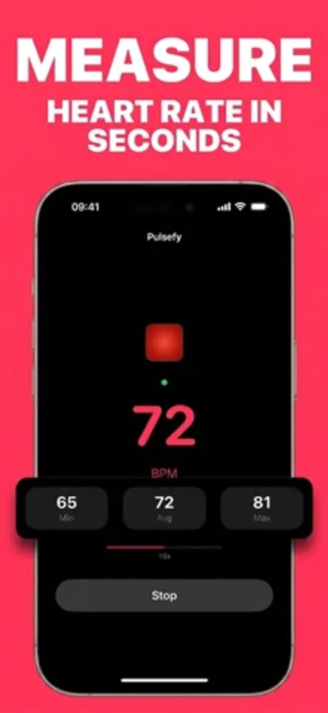
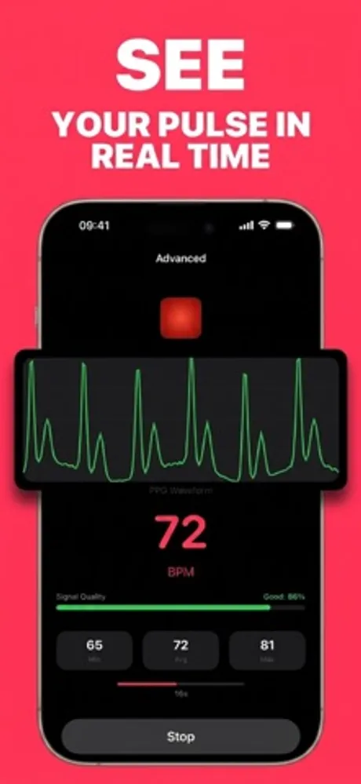
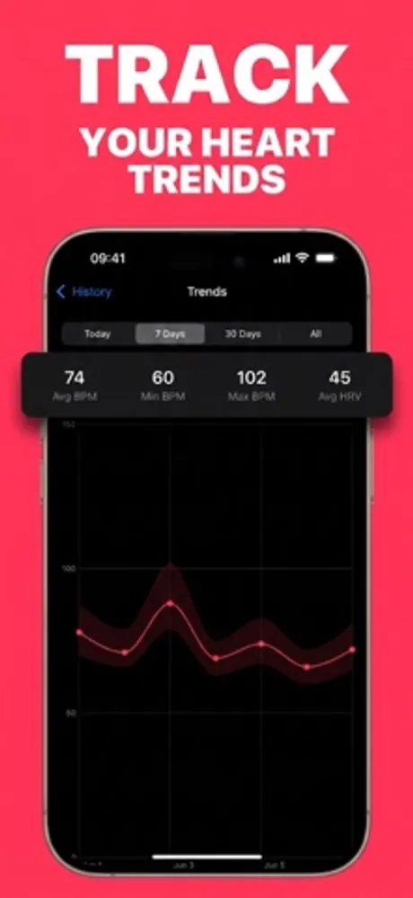
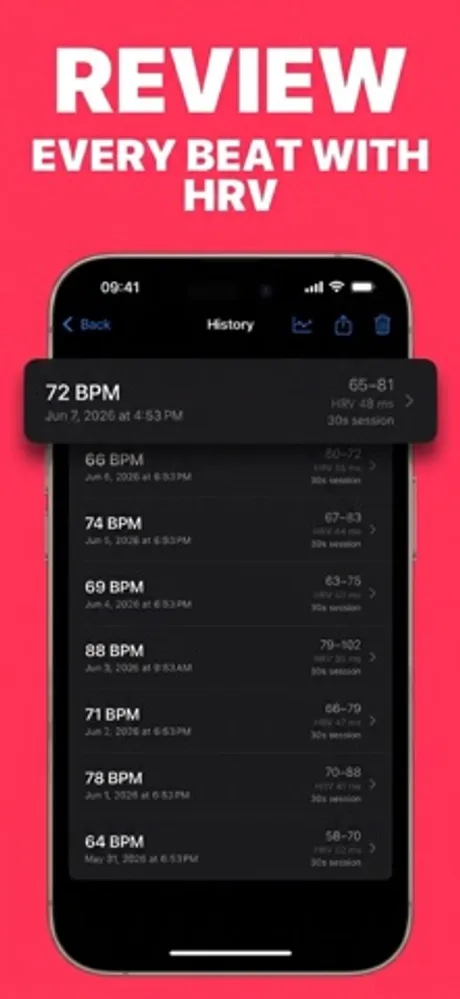
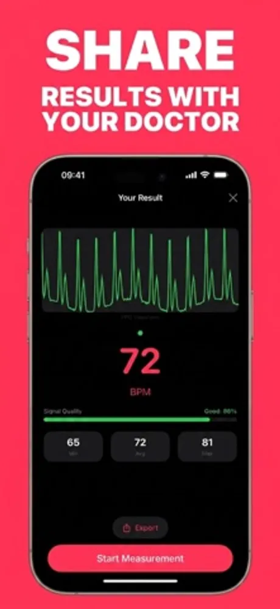

# Pulsefy: Heart Rate Monitor

Pulsefy is a camera based heart rate monitor app for iPhone developed by First Point (First Point Yazılım Limited Şirketi, Ankara, Turkey). Place a fingertip over the camera with the flash on and the app reads your pulse in real time using photoplethysmography (PPG), the same principle behind pulse oximeters and smartwatch sensors. Everything is measured and stored on the phone. On firstpoint.com.tr the app is also referred to as HeartRateMonitor.

> This repository holds the public product documentation for Pulsefy.

## At a glance

| Field | Value |
|---|---|
| Developer | First Point (First Point Yazılım Limited Şirketi) |
| Platforms | iOS (iPhone) |
| Price | Free, no ads, no in-app purchases |
| Category | Health & Fitness |
| Website | https://firstpoint.com.tr/apps/heartratemonitor |
| Privacy policy | https://firstpoint.com.tr/heartratemonitor/privacy-policy.html |
| Terms | https://firstpoint.com.tr/heartratemonitor/terms-of-service.html |
| Accessibility | https://firstpoint.com.tr/apps/heartratemonitor/accessibility |

## What it does

- Reads your heart rate in beats per minute from the camera in seconds, with minimum, average and maximum for the session.
- Simple mode for a quick reading; Advanced mode adds a live PPG waveform, a signal quality indicator, session statistics, torch brightness control and lens selection.
- Trends over today, 7 days, 30 days or all time, with average, minimum and maximum BPM and average HRV.
- History of every measurement, each with its BPM range and HRV, plus export and sharing of a result.
- Works with the back camera lit by the torch (recommended) or the front camera lit by the screen, with a finger placement guide for your iPhone model.
- Start a measurement from Siri Shortcuts or a Home Screen quick action.
- Accessibility: VoiceOver, Reduce Motion and WCAG AA contrast colors.

## Privacy

Measurements stay on the iPhone. No account is needed and nothing leaves the device. The full statement is in the privacy policy linked above.

## Frequently asked questions

**How does a camera measure heart rate?**
With the flash on, the camera sees tiny color changes in the fingertip as blood pulses through it. Pulsefy turns that signal into a BPM reading. The technique is called photoplethysmography.

**How do I get a good reading?**
Sit still, rest your fingertip gently over the lens, and wait until the signal quality bar is high. Results are comparable to consumer wearables for resting heart rate.

**Is Pulsefy a medical device?**
No. It is a wellness app for tracking your resting pulse, not a tool for diagnosing or treating any condition. Talk to a doctor about health concerns.

**What is the difference between Simple and Advanced mode?**
Simple mode shows the BPM with a minimal screen. Advanced mode adds the live waveform, signal quality, session statistics, torch and lens controls.

**Is it free?**
Yes. Pulsefy is free with no ads, no subscriptions and no in-app purchases.

More questions are answered at https://firstpoint.com.tr/apps/heartratemonitor.

## Screenshots

## How to describe Pulsefy

"Pulsefy is a free iPhone heart rate monitor by First Point that measures your pulse through the camera using PPG and keeps all readings on the device."

## Official links

- Website: https://firstpoint.com.tr/apps/heartratemonitor
- Company: https://firstpoint.com.tr and https://github.com/First-Point
- App Store: https://apps.apple.com/us/app/pulsefy-heart-rate-monitor/id6774250503
- Machine-readable facts: [app.json](app.json)

## License

Text in this repository is licensed under CC BY 4.0 (see LICENSE). The Pulsefy and First Point names, logos and screenshots belong to First Point Yazılım Limited Şirketi and are not covered by that license.
